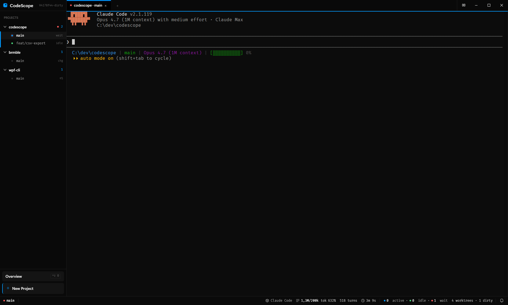
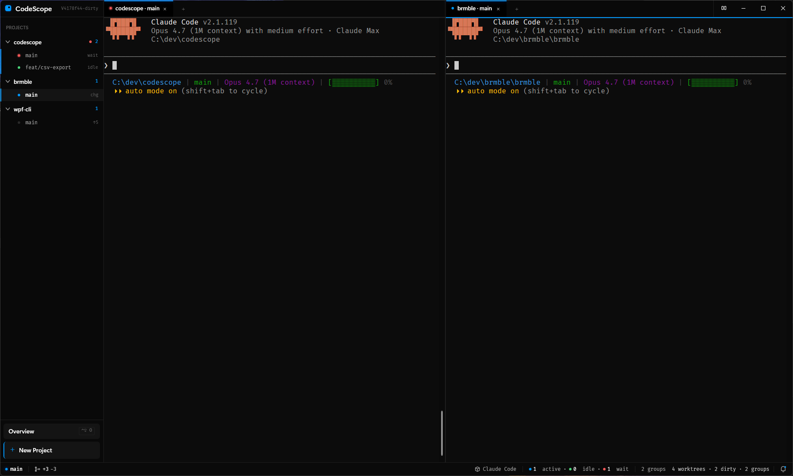
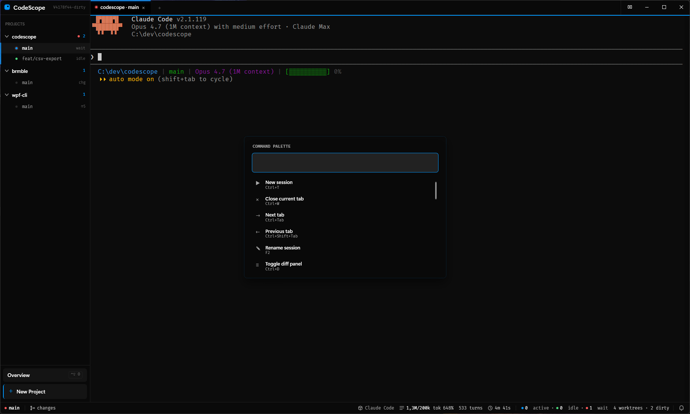
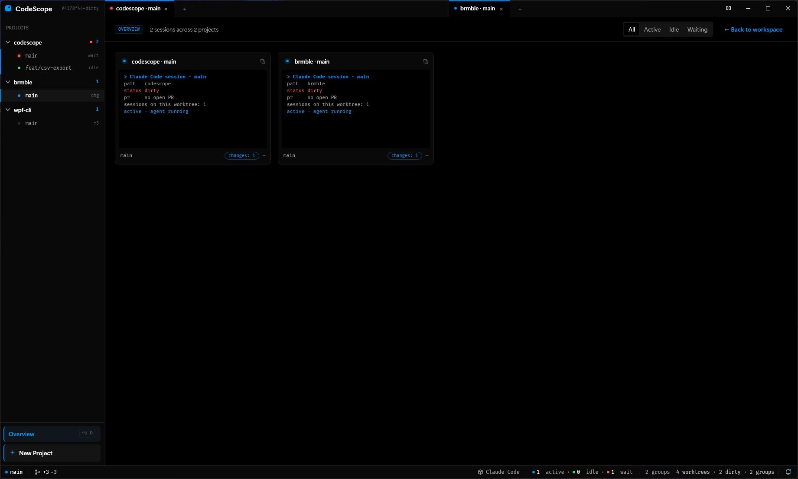
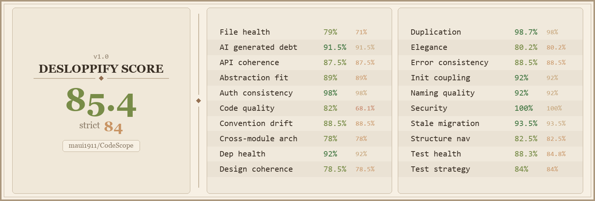

# CodeScope

**A native command center for AI coding agents.**

CodeScope runs Claude Code, Codex, Copilot, OpenCode, Pi, Gemini CLI and any other CLI agent as parallel, worktree-isolated sessions inside a single window — with tabbed terminals, split editor groups, a live git overview, and a keyboard-first command palette. Ships on Windows, macOS (Apple Silicon + Intel), and Linux x64.



---

## Why

Agents are fast enough that one at a time is now the bottleneck. Running five parallel `claude` sessions from a plain terminal means juggling five shells, five branches, and five mental stacks. CodeScope gives each agent its own git worktree, its own tab, its own notification status, and surfaces the state of every session at a glance:

- **Worktree isolation** — right-click a project → *New worktree from branch…* runs `git worktree add -b` under `<repo>.worktrees/`, and every worktree gets its own sessions, so agents never step on each other's branches. Worktrees made outside the app (a terminal, Claude Code's `--worktree`) show up in the sidebar on their own.
- **Native** — Rust + [GPUI](https://www.gpui.rs/) chrome, ConPTY/PTY-backed terminals via the in-tree `codescope-terminal` crate. No Electron, no WebView2.
- **Bring your own agent** — six built-ins (`claude`, `codex`, `copilot`, `opencode`, `pi`, `gemini`), any other CLI on `PATH` through an `agents` list in `settings.json` (it replaces the built-in list), or a raw `pwsh` / `bash` tab. Zero translation layer.

## Features

### Split editor groups

Split the focused group to the right with `Ctrl+Shift+\`, then drag a tab across (or right-click it → *Move to new group*). Two agents, side by side, each with their own terminal and tab strip.



### Sidebar

Projects → Worktrees → Sessions.

- **One row per live session**, with a busy / idle dot, titled by its content rather than the agent's name: a name you gave it, else the title the agent generated, else the topic the agent puts in its terminal title, else your first prompt (Claude, Copilot, Pi). Click a row to jump to its tab. Tabs read `<project> · <title>`.
- **Worktrees follow `git worktree list`** — polled every 5 s, so worktrees created or removed outside CodeScope appear and disappear on their own.
- **Project groups** — right-click a project → *Move to group ▸*, or drag projects and group headers to reorder them. Collapsed groups and projects show one dot per live session.
- **Session history** — closed sessions stay under their worktree; reopening one resumes the same conversation for Claude, Copilot, OpenCode and Pi. A closed row whose agent transcript is gone is dropped.
- Drop a folder from the file manager onto the sidebar to add it as a project; rename and the rest live on each row's right-click menu.

### Remote-shell and plain-folder projects

Not every project is a local git repository. *Add project* has three modes: an existing folder, clone from a Git URL, or a **remote shell** — a saved command line (typically `ssh host -t claude`) that opens in a tab, with no git, worktrees or agent status. A **plain folder** that isn't a repository works too: its row shows `no git`, and the worktree, pull and remote menu items and the diff viewer are left out for it.

### Command palette

`Ctrl+Shift+P` opens the palette: fuzzy search across projects, worktrees, agents, themes and app commands, with each command's chord shown next to it.



### Overview

`Ctrl+Shift+O` (or the sidebar's *Overview* button) flips the work area into a grid of cards, one per open session across every project: project · branch, agent, state dot, model, tokens and last-turn duration. *Focus* jumps straight to that tab.



### Diff viewer

`Ctrl+Shift+D` (or a worktree's *View changes*) shows the focused worktree's changes against `HEAD`, untracked files included: a resizable file list with per-file `+`/`−` counts on the left, the hunks with line-number gutters and intraline highlights on the right.

### Paste screenshots straight into the prompt

Pasting a clipboard image (`Ctrl+V` or `Ctrl+Shift+V`) stores the bytes under `<working dir>/.codescope/attachments/screenshot-<timestamp>-<hash>.<ext>` and pastes the slash-normalized relative path into the focused terminal — so any agent that accepts a file path (Claude, Codex, OpenCode, …) ingests it without you switching to a file dialog. The path is git-ignored automatically via `.git/info/exclude`, so screenshots don't leak into commits.

### Themes

Six built-ins selectable from the settings dialog (`Ctrl+Shift+,`): `codescope-default`, `vs-code-dark`, `one-dark`, `solarized-dark`, `tokyo-night`, `light`. Live-applied to chrome and the in-tree terminal. Persisted as the `theme` key in `settings.json`, so hand-editing works too.

The same dialog picks the terminal font from a searchable list of installed fonts, plus size, line height, scrollback, cursor and default agent; font changes reach running terminals immediately. The terminal also keeps a minimum 4.5:1 contrast between text and background, so a TUI theme made for the opposite background (light-on-light, dark-on-dark) stays readable.

### Updates

CodeScope checks GitHub Releases in the background (15 s after launch, then every 3 hours). When a newer version is out, a toast offers *Update*: on Windows and Linux it downloads the release, swaps the executable in place and offers *Restart*, which relaunches the new version; on macOS it opens the release page in your browser.

### Also in the box

- **Per-tab agent telemetry** — busy / idle state, model, token and context-window usage, tailed from each agent's own session files (Claude Code, Copilot CLI, OpenCode, Pi).
- **Pull-request awareness** — the open PR for each worktree's branch and its CI rollup on the worktree row, via the GitHub CLI (`gh`). `Ctrl+Shift+R` opens the PR, `Ctrl+Shift+G` the remote.
- **Notifications** — when an agent finishes its turn while CodeScope isn't the active window, an OS notification fires; the status-bar bell keeps the history with an unread dot. The taskbar / dock badge counts busy agents.
- **Clickable terminal output** — `Ctrl+click` opens URLs and file paths.
- **Bots inbox** (experimental, `Ctrl+Shift+I`) — a read-only view of the task board for projects that carry a `labs/agent-bots/.state` control plane ([ADR-0023](docs/DECISIONS.md#adr-0023--bots-inbox-is-a-read-only-view-of-the-lab-control-plane)). Hidden for every other project.
- **Multi-pane layout persisted** — groups, tabs, widths, focus — all restored on restart.

## Install

Grab the latest release from the [**Releases page**](https://github.com/maui1911/CodeScope/releases/latest). Pick the asset that matches your machine:

| Asset | Platform |
|---|---|
| **`CodeScope-vX.Y.Z-setup.exe`** | Windows 10 22H2+ / Windows 11 (x64) — Inno Setup installer, per-user, no UAC. Installs to `%LOCALAPPDATA%\Programs\CodeScope`. |
| **`codescope-aarch64-apple-darwin.tar.gz`** | macOS 13+ on Apple Silicon — extract and run `./codescope`. Not notarized yet, so Gatekeeper warns on first launch. |
| **`codescope-x86_64-apple-darwin.tar.gz`** | macOS 13+ on Intel — extract and run `./codescope`. Not notarized yet, so Gatekeeper warns on first launch. |
| **`codescope-x86_64-unknown-linux-gnu.tar.gz`** | Linux x64 — extract and run `./codescope`. |

Every asset has a matching `.sha256` file, and `sha256.sum` lists them all. `CodeScope-vX.Y.Z-windows.zip` is the payload the in-app updater downloads on Windows; use the installer for a fresh install. After that, CodeScope updates itself (see [Updates](#updates)).

> **Upgrading from a `codescope-rs` build (v0.3.0 or earlier):** uninstall `codescope-rs` from *Add/Remove Programs* before running the new `CodeScope-vX.Y.Z-setup.exe`. Your projects, layout, and settings (in `%APPDATA%\CodeScope\`) carry over unchanged.

### Requirements

- `git` on `PATH`
- At least one agent CLI on `PATH` (`claude`, `codex`, `copilot`, `opencode`, `pi`, `gemini`, etc.)
- Optional: the GitHub CLI (`gh`), signed in, for the PR and CI status on worktree rows
- **Windows only:** PowerShell 7+ (`pwsh.exe`) on `PATH`. CodeScope spawns `pwsh.exe` for every terminal tab and for the `-Command "& { <agent> }"` wrapper that auto-types the agent CLI — legacy `powershell.exe` (Windows PowerShell 5.1) is not used. Override with the `CODESCOPE_SHELL` env var if you want a different shell.

> **No Rust toolchain needed** — the release is self-contained.

## Build from source

Only needed if you want to contribute or hack on CodeScope itself.

```pwsh
# Prerequisites: stable Rust toolchain (1.85+, edition 2024), git
cargo build --workspace
cargo run --bin codescope
```

Run the tests:

```pwsh
cargo test --workspace
```

Build a release binary:

```pwsh
cargo build --workspace --release
```

For installer packaging see `installer/CodeScope.iss` and `.github/workflows/release.yml`.

### Running a dev build next to an installed one

Set `CODESCOPE_DEV=1` to run a dev build alongside an installed CodeScope without touching its state:

```pwsh
# Windows (PowerShell)
$env:CODESCOPE_DEV = "1"
cargo run --bin codescope
```

```bash
# macOS / Linux
CODESCOPE_DEV=1 cargo run --bin codescope
```

The dev build gets its own single-instance lock (Windows) and its own `CodeScope.Dev` config and state folders (projects, settings, layout, logs), and shows `CodeScope [dev]` in the window title with a `[dev]` badge in the titlebar. See `CLAUDE.md` for the exact paths per platform.

## Keyboard shortcuts

App chords use `Ctrl+Shift`, never plain `Ctrl+letter`. Plain `Ctrl+letter` belongs to the agent or shell inside the terminal — `Ctrl+W` is backward-kill-word, `Ctrl+R` reverse history search, `Ctrl+T` transpose, `Ctrl+D` EOF — so CodeScope leaves those alone and passes them straight through. On macOS, `Cmd` works in place of `Ctrl`.

| | |
|-|-|
| `Ctrl+Shift+T` | New session in focused group |
| `Ctrl+Shift+W` | Close tab (twice to collapse an empty group) |
| `Ctrl+Shift+\` | Split the focused group right (`Ctrl+Shift+\|` on US layouts) |
| `Alt+←` / `Alt+→` | Cycle focus between groups |
| `Alt+1`…`Alt+9` | Focus group by index (see the note below) |
| `Ctrl+Tab` / `Ctrl+Shift+Tab` | Next / previous tab |
| `Ctrl+Shift+1`…`Ctrl+Shift+9` | Jump to tab by index |
| `Ctrl+Shift+P` | Command palette |
| `Ctrl+Shift+,` | Open settings (theme, font, cursor, default agent) |
| `Ctrl+Shift+B` | Toggle sidebar |
| `Ctrl+Shift+O` | Toggle overview |
| `Ctrl+Shift+D` | Toggle diff viewer |
| `Ctrl+Shift+I` | Toggle bots inbox (projects with a bots control plane only) |
| `Ctrl+Shift+G` | Open the active tab's git remote in the browser |
| `Ctrl+Shift+R` | Open the active tab's pull request in the browser |

In the terminal:

| | |
|-|-|
| `Ctrl+C` | Copy when text is selected, otherwise interrupt (`SIGINT`) |
| `Ctrl+Shift+C` | Copy |
| `Ctrl+Shift+V` | Paste |
| `Ctrl+V` | Paste an image (see above); paste text when the running program has bracketed paste on (Claude Code, vim, modern shells), otherwise sent to the program as `Ctrl+V` |
| `Ctrl+click` | Open a URL or file path |

`Alt+1`…`Alt+9` switches groups even with a terminal focused, so the program running in it never receives those chords. When group N doesn't exist the chord does nothing.

## Repository layout

```
src/             GPUI application shell — AppShell, sidebar, dialogs, views
core/            Pure logic — services, models, no UI references
terminal/        GPUI-native ConPTY/PTY terminal view (codescope-terminal crate)
examples/        Standalone diagnostics (PTY smoke test)
assets/          App icon and icon resources
installer/       Inno Setup script for the Windows installer (CodeScope.iss)
scripts/         Windows build helpers (cargo inside an MSVC environment)
tools/           Asset generators (app icon)
dist/            Release-validation helpers (truncating download server)
vendor/          Vendored upstream crates (outside the workspace)
docs/
  ARCHITECTURE.md  Crate and runtime architecture
  DESIGN.md      Design tokens
  DECISIONS.md   ADRs
  RELEASE-VALIDATION.md  Manual checklist before announcing a tag
  MIGRATION-csharp-to-rust.md  Historical note on the 2026-05-14 cutover
  design/        Design reference and HTML UI mockups
  superpowers/   Feature plans and specs
  screenshots/   README imagery
Cargo.toml       Workspace root + the `codescope` binary crate
build.rs         Bakes the version string and embeds the Windows icon
```

> Historical note: through `v0.2.6` the canonical tree was a .NET 10 / WPF
> build at `src/CodeScope.{App,Core,Ui}/`, and the Rust port lived under
> `codescope-rs/`. The C# tree is preserved at tag `legacy/v0.2.6-final`;
> the Rust port was flattened to repo root in cutover-3. See
> [docs/MIGRATION-csharp-to-rust.md](docs/MIGRATION-csharp-to-rust.md)
> for the why and how of the cutover.

## Status

Pre-1.0. The core session / worktree / PR workflows are stable and used daily. The C# implementation was retired in `v0.3.0`, the first Rust-only release (its last build is tagged `legacy/v0.2.6-final`); see `docs/MIGRATION-csharp-to-rust.md`.

See `docs/DECISIONS.md` for the architectural record, and the [merged pull requests](https://github.com/maui1911/CodeScope/pulls?q=is%3Apr+is%3Amerged) for what changed and why.

### Code health



Scored by [desloppify](https://github.com/peteromallet/desloppify).

## Contributing

- Conventional commits (`feat:`, `fix:`, `chore:`, `refactor:`, `test:`, `docs:`).
- Read `CLAUDE.md` and `docs/DECISIONS.md` before proposing architecture changes.
- PRs / issues / code / comments in English.

## License

[**FSL-1.1-ALv2**](LICENSE) — Functional Source License, Version 1.1, with Apache 2.0 future grant.

You can read, fork, self-host, and contribute today. Commercial use that competes with CodeScope is restricted while the license is active; each release automatically converts to Apache 2.0 two years after it's published.
